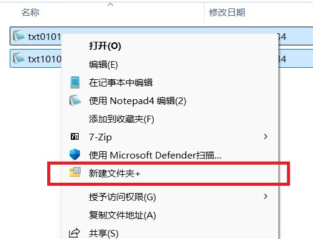
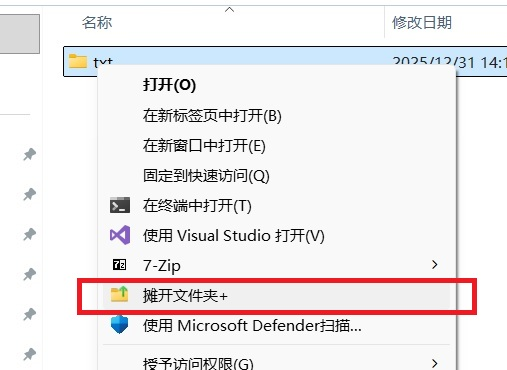

# anpho's Extensions

[English](#english) · [简体中文](#简体中文)

Two commands for the Windows Explorer right-click menu: **New Folder +** and **Break Folders +**.

| New Folder + | Break Folders + |
| --- | --- |
|  |  |

## English

A native C++ shell extension for Windows 10 and Windows 11 (x86 and x64). It installs per user: no administrator rights, no Visual C++ Redistributable, no .NET, no MFC, no telemetry.

### Features

#### New Folder +

Select files and/or folders, right-click, and choose **New Folder +**.

- A folder is created next to the first selected item, named after the longest common prefix of the selected names (file extensions are stripped). If there is no usable prefix, the first item's name is used.
- All selected items are moved into it.
- The command is hidden when exactly one folder is selected.

#### Break Folders +

Select one or more folders and choose **Break Folders +**.

- Every file at every depth below each selected folder moves to that folder's parent.
- The empty folder tree is left in place; delete it yourself.
- If a move fails, an error dialog is shown.

Both commands use shell file operations, so **Ctrl+Z** in Explorer undoes them.

### Install

1. Download `ExplorerExtensionSetup.exe` from [Releases](https://github.com/anpho/ExplorerExtensions/releases) and run it. No administrator rights are needed. To install for all users, run the installer as administrator.
2. The installer copies the files to `%LOCALAPPDATA%\ExplorerEnhancement`, registers the extension, adds a Start Menu shortcut for the manager, and writes an uninstall entry.
3. If the commands do not appear, restart Windows Explorer.

On Windows 11 the commands are classic menu entries: click **Show more options** (or press **Shift+F10**).

Manual installation: extract `Extensions-x86-<version>.zip` or `Extensions-x64-<version>.zip` and run `regsvr32 ExplorerEnhancement_x64.dll` (`x86` on 32-bit Windows) from a normal command prompt. Unregister with `regsvr32 /u`; for all users, run `ExplorerEnhancementManager_<arch>.exe /install` from an elevated prompt. A manual installation creates no shortcuts and no uninstall entry.

### Manager

The Start Menu shortcut opens the manager, which has one checkbox per command and **Apply**.

- Opening the manager when the extension is not registered registers it; if Windows blocks per-user COM registration, it offers a UAC-assisted all-users install.
- **Shift+click Exit** unregisters the extension after a confirmation.
- The enabled/disabled state is stored per user in `HKCU\Software\anpho\ExplorerEnhancement`.
- Command line (used by the installer): `/install` and `/uninstall` — no window, exit code `0` on success and `1` on failure.

### Uninstall

Use **Settings > Apps > anpho's Extensions > Uninstall**, or run `%LOCALAPPDATA%\ExplorerEnhancement\uninstall.exe` (silent: `/S`). Restart Windows Explorer afterwards.

### Notes

- Local and UNC filesystem paths only: no virtual folders, archives, or cloud placeholders.
- Paths longer than `MAX_PATH` (260 characters) are not supported.
- **Break Folders +** moves files only; empty folders remain.
- Release builds are not code-signed, so Windows SmartScreen may warn on first run.
- The project is proprietary: free for personal, non-commercial use; commercial use requires a paid license (see [LICENSE.md](LICENSE.md)).

### Build

See [how-to-build.md](how-to-build.md). GitHub Actions builds tagged releases.

### Contact

support@anpho.cn · [@anpho](https://x.com/anpho)

---

## 简体中文

一个原生 C++ Shell 扩展，支持 Windows 10 和 Windows 11（x86 与 x64）。按用户安装：无需管理员权限，不需要 Visual C++ 运行库、.NET 或 MFC，也没有遥测。

### 功能

#### 新建文件夹+

选中文件或文件夹，右键选择 **新建文件夹+**。

- 在第一个选中项旁创建文件夹，名称取所选名称的最长公共前缀（先去掉文件扩展名）。没有可用的公共前缀时，使用第一项的名称。
- 所有选中项都会移入该文件夹。
- 恰好只选中一个文件夹时，该命令不显示。

#### 摊开文件夹+

选中一个或多个文件夹，右键选择 **摊开文件夹+**。

- 所选文件夹下所有层级的所有文件都移动到该文件夹的上一级。
- 空的文件夹结构会保留在原位，请自行删除。
- 移动失败时会弹出错误对话框。

两个命令都使用 Shell 文件操作，可用资源管理器的 **Ctrl+Z** 撤销。

### 安装

1. 从 [Releases](https://github.com/anpho/ExplorerExtensions/releases) 下载 `ExplorerExtensionSetup.exe` 并运行。无需管理员权限；如需安装给所有用户，请以管理员身份运行安装程序。
2. 安装程序会把文件复制到 `%LOCALAPPDATA%\ExplorerEnhancement`，注册扩展，为管理器创建开始菜单快捷方式，并写入卸载条目。
3. 如果命令没有出现，请重启 Windows 资源管理器。

Windows 11 上这两个命令属于传统菜单项：点击 **显示更多选项**（或按 **Shift+F10**）。

手动安装：解压 `Extensions-x86-<version>.zip` 或 `Extensions-x64-<version>.zip`，在普通命令提示符中运行 `regsvr32 ExplorerEnhancement_x64.dll`（32 位 Windows 使用 `x86`）。用 `regsvr32 /u` 注销；要给所有用户安装，请以管理员身份运行 `ExplorerEnhancementManager_<arch>.exe /install`。手动安装不会创建快捷方式，也不会写入卸载条目。

### 管理器

开始菜单快捷方式可打开管理器，其中每个命令对应一个复选框，另有 **应用** 按钮。

- 扩展未注册时打开管理器会自动注册；如果 Windows 禁止用户级 COM 注册，会提供经 UAC 的“所有用户”安装。
- **按住 Shift 点「退出」** 会在确认后注销扩展。
- 启用/禁用状态按用户保存在 `HKCU\Software\anpho\ExplorerEnhancement`。
- 命令行（安装程序使用）：`/install` 和 `/uninstall` —— 不显示窗口，成功返回 `0`，失败返回 `1`。

### 卸载

打开 **设置 > 应用 > anpho's Extensions > 卸载**，或运行 `%LOCALAPPDATA%\ExplorerEnhancement\uninstall.exe`（静默：`/S`）。之后重启 Windows 资源管理器。

### 说明

- 仅支持本地和 UNC 文件系统路径：不支持虚拟文件夹、压缩包或网盘占位文件。
- 不支持超过 `MAX_PATH`（260 个字符）的路径。
- **摊开文件夹+** 只移动文件，空文件夹会保留。
- 发布版本未做代码签名，首次运行时 Windows SmartScreen 可能提示。
- 本项目为专有软件：个人非商业使用免费；商业使用需要付费许可证（见 [LICENSE.md](LICENSE.md)）。

### 构建

见 [how-to-build.md](how-to-build.md)。GitHub Actions 会构建标签发布的版本。

### 联系方式

support@anpho.cn · [@anpho](https://x.com/anpho)
