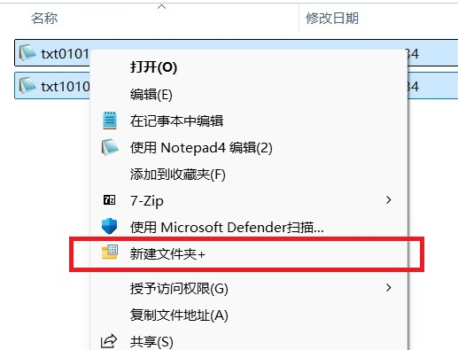
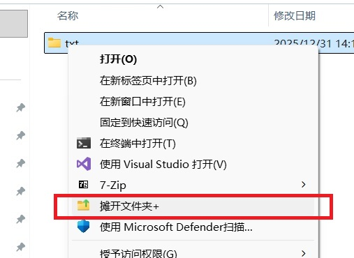

[](https://github.com/anpho/ExplorerExtensions/actions/workflows/msbuild.yml)
[](https://github.com/anpho/ExplorerExtensions/actions/workflows/create-release.yml)

# ExplorerExtensions

[English](README.md) | 简体中文

anpho's Extensions 为 Windows 资源管理器右键菜单添加两个命令：**新建文件夹+** 和 **摊开文件夹+**。它是一个原生 C++ Shell 扩展，支持 Windows 10 和 Windows 11。按用户安装，不需要管理员权限、Visual C++ 运行库、.NET 或 MFC。

## 功能

### 新建文件夹+

选中一个或多个文件/文件夹，右键单击，选择 **新建文件夹+**。

- 在第一个选中项旁边创建一个新文件夹。
- 文件夹名称取自所有选中项名称的最长公共前缀，并先去掉文件扩展名。如果没有可用的公共前缀，则使用第一个选中项的名称。
- 所有选中项都会移动到新文件夹中。
- 移动使用系统 Shell 文件操作，可以通过资源管理器的撤销（**Ctrl+Z**）还原。

当恰好只选中一个文件夹时，该命令不会显示。选中文件不受此限制。



### 摊开文件夹+

选中一个或多个文件夹，右键单击，选择 **摊开文件夹+**。

- 对每个选中的文件夹，将其下所有层级的所有文件移动到该文件夹的上一级文件夹。
- 空的文件夹结构会留在原位，请在不再需要时自行删除。
- 移动使用系统 Shell 文件操作，可以通过资源管理器的撤销（**Ctrl+Z**）还原。
- 如果移动失败，会弹出错误对话框，而不是静默失败。



### 使用方法

1. 在资源管理器中选中项目。
2. 右键单击，选择 **新建文件夹+** 或 **摊开文件夹+**。
3. 在 Windows 11 上，先点击 **显示更多选项**（或按 **Shift+F10**）。

## 系统要求

- Windows 10 或 Windows 11，32 位或 64 位。
- 无需管理员权限。所有内容都按用户安装和注册。
- 无需安装 Visual C++ 运行库：程序使用静态 C++ 运行库。
- 不依赖 .NET，不使用 MFC。

## 安装

### 使用安装程序（推荐）

1. 从 [Releases](https://github.com/anpho/ExplorerExtensions/releases) 下载 `ExplorerExtensionSetup.exe`。
2. 运行安装程序。无需管理员权限。
3. 安装程序会把文件复制到 `%LOCALAPPDATA%\ExplorerEnhancement`，注册扩展，为管理器创建开始菜单快捷方式，并写入卸载条目。
4. 安装程序会注册扩展并打开管理器。如果右键菜单没有出现，请重启 Windows 资源管理器。

### 手动安装

根据 Windows 架构，从 [Releases](https://github.com/anpho/ExplorerExtensions/releases) 下载 `Extensions-x86-<version>.zip`（32 位 Windows）或 `Extensions-x64-<version>.zip`（64 位 Windows），然后解压。

在解压后的文件夹中打开一个普通（非管理员）命令提示符，执行对应架构的命令。

32 位 Windows：

```bat
regsvr32 ExplorerEnhancement_x86.dll
```

64 位 Windows：

```bat
regsvr32 ExplorerEnhancement_x64.dll
```

然后重启 Windows 资源管理器。

注意：

- 注册是按用户进行的，请使用之后要使用右键菜单的同一用户运行 `regsvr32`。
- 使用 `regsvr32 /u ExplorerEnhancement_<arch>.dll` 注销。
- 手动安装不会创建开始菜单快捷方式，也不会写入卸载条目。

## 启用或禁用命令

安装程序会为管理器创建开始菜单快捷方式。也可以从安装目录运行 `ExplorerEnhancementManager_<arch>.exe`。管理器中有 **摊开文件夹+** 和 **新建文件夹+** 两个复选框，以及 **应用**、**关于** 和 **退出** 按钮。

- 被禁用的命令按用户记录在 `HKCU\Software\Microsoft\Windows\CurrentVersion\Shell Extensions\Blocked`。
- 应用修改后需要重启 Windows 资源管理器。
- 如果扩展没有注册（例如只复制了 DLL，或手动注销过），管理器会给出提示并禁用 **应用**。

管理器也支持命令行：

- `ExplorerEnhancementManager_<arch>.exe /install` 注册 exe 旁边的 DLL。
- `ExplorerEnhancementManager_<arch>.exe /uninstall` 注销它。

两个命令都不显示窗口，成功时返回退出码 `0`，失败时返回 `1`。安装程序使用的就是这两个命令。

## 卸载

- 打开 **设置 > 应用**，找到 **anpho's Extensions**，点击 **卸载**。
- 或运行 `%LOCALAPPDATA%\ExplorerEnhancement\uninstall.exe`。
- 卸载程序会用 `/uninstall` 调用管理器，然后删除文件、开始菜单快捷方式、卸载条目，以及按用户的注册信息和禁用记录。
- 静默卸载：`uninstall.exe /S`。
- 卸载后重启 Windows 资源管理器。

## 说明与限制

- **Windows 11 菜单：** 这两个命令是传统右键菜单处理程序，会出现在 **显示更多选项**（Shift+F10）中，不会出现在 Windows 11 新的顶层菜单里。
- **仅支持文件系统项目：** 命令只支持本地路径和 UNC 路径。虚拟文件夹、压缩包或网盘等不是真实文件系统路径的项目不受支持。
- **空文件夹会保留：** **摊开文件夹+** 只移动文件。空的文件夹结构会一直留在原位，直到你手动删除。
- **长路径：** 不支持长度超过 `MAX_PATH`（260 个字符）的路径。
- **只选中一个文件夹时：** 恰好只选中一个文件夹时，**新建文件夹+** 不会显示。

## 构建

构建方式见 [how-to-build-cn.md](how-to-build-cn.md)，其中包括构建前提、本地构建与安装程序构建步骤、版本号管理和发布流程。GitHub Actions 会构建并签名标签发布的版本。

## 许可证

本项目为专有软件。个人非商业使用免费。任何商业使用都需要付费许可证，请联系 support@anpho.cn 获取。

完整条款见 [LICENSE.md](LICENSE.md)。

## 联系方式

- 邮箱：support@anpho.cn
- X（Twitter）：[@anpho](https://x.com/anpho)
